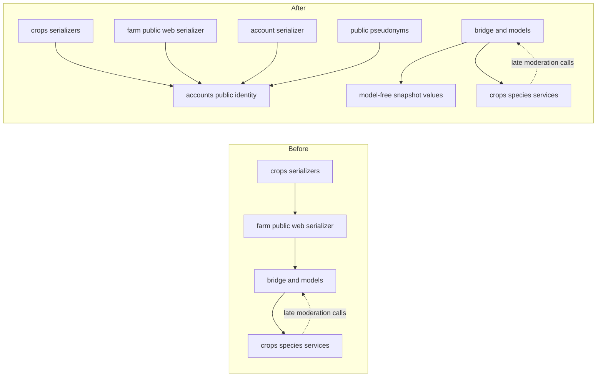

# Crop-library boundary audit (#1117)

This is an incremental audit of main
`dd9226f732942424a21487de0d67d66ffbccb892` (the #1116 quality-gate merge),
following merged #1067/#1082,
#1102 and #1110. No related implementation PR was open at selection time.
The design remains a modular monolith. Crop facts and safe presentation are
shared; project ownership and public moderation keep separate workflows.
This pass introduces no transport, model, schema, API or UI behavior change.

## Backend inventory

An AST inventory of production Python modules under `farm`, `crops`,
`accounts` and `notifications` (excluding tests/migrations) found 220 modules
and 109 cross-app import sites before this change. Both startup and
function-local imports were recorded separately. Imports are module-level
evidence, not a call graph or proof of a runtime failure.

| Concrete boundary | Ownership and decision |
| --- | --- |
| `farm.models.Crop` / `Project` versus `PublicCrop` | Private ownership versus shared-library data is already explicit. Public models remain physically in farm to preserve migration/table identity. No model move. |
| `farm.services.public_crops` → `crops.services.find_species_by_common_name` | Application bridge uses canonical species lookup. Publishing, importing, one-time copies, links, pins, synchronization, versioning and moderation coordination remain here. |
| `crops.services.remove_public_crops_for_rejected_species` and `apply_public_crop_species_relinks_for_approved_species` → bridge | Deliberate late imports call `remove_public_crop`, `cancel_public_crop_species_relinks` and `complete_public_crop_species_relinks`. Keep the actual project/link policy and transactions in one place. |
| `crops.services` → `farm.services.public_crop_trade_names` | Search/identity reuse `variety_identity_query` and `variety_search_query`. The containing module also owns event/edit orchestration; a future query-only split is a candidate, not a reason to copy identity rules now. |
| `crops.serializers` → farm public web serializer | Removed: `get_public_user_label` now comes from `accounts.public_identity`, which imports no domain models or serializers. The legacy import is still an alias. |
| Account public-name field, public library labels and anonymous-author classification | One canonical public-name helper. It exposes only an explicit `PublicProfile.public_display_name`, with no fallback to email, login or private display name. Topic-scoped pseudonym numbering stays in `public_pseudonyms`. |
| `crops.serializers.get_request_region` → optional `farm.project_context` | Accepted request-context adapter for regional display; it does not establish a second project authorization policy. Companion-note localization also remains shared. |
| `crops.views` → `accounts.demo_access` and permissions → account trust | Accepted authentication/guest/trust boundary. A public-library workflow is not exempt from account rules. |
| `accounts.services` / serializers → farm memberships and project resolution | Account deletion, membership and active-project selection are application workflows. They are not moved into public-name formatting. |
| Farm/crops services → `notifications.services.create_notification` | Late workflow calls emit existing notifications. Notifications' service itself has no direct import back into these domains; recipients/payloads remain caller supplied. |

The concrete cross-domain logical cycle is
`farm.services.public_crops → crops.services → (late) public_crops`.
Including late imports connects it to model/inheritance/trust helpers; that
does not mean all those modules execute recursively during startup. The
startup-only inventory found one internal package aggregation cycle,
`farm.models ↔ farm.models.notes`, outside this extraction. Normal Django
startup and API regression tests continue to load it successfully. This
pass does not claim to remove every logical cycle from the monolith.

The bridge shrinks from 4,026 to 3,999 lines by moving three cohesive,
model-free value operations into `farm.services.public_crop_values`:

- `comparable_copy_fields`: comparison-only seed-unit normalization;
- `json_safe`: the existing Django JSON encoding round trip for snapshots;
- `same_snapshot_value`: existing equality across empty snapshot spellings.

The original `_comparable_copy_fields`, `_json_safe` and
`_same_snapshot_value` names remain aliases on `public_crops`. No caller,
transaction, lock, permission check, write or snapshot field set is moved.
The small extraction makes these value contracts testable without loading
the application's models, rather than redistributing orchestration merely
to reduce a line count.

Cross-app edge count is not an optimization target: explicitly importing the
account-owned helper from its consumers adds direct identity edges while
removing the library serializer's dependency on an entire farm web serializer
and its transitive workflows. Regression tests guard the removed web-serializer
import, compatibility aliases and cold imports without domain-model loading.

## Frontend reuse and deliberate differences

| Concrete files/components | Shared fact or deliberate distinction |
| --- | --- |
| `CropForm`, `CropSeedDetails`, `CropVarietiesOverview` | Already reused by `crop-library/pages/PublicCropLibraryPage.tsx` and project crops. Keep one presentation/edit implementation with existing form-kind props. |
| `publicCropFormAdapter.publicCropToCropFormData` / `buildPublicCropUpdatePayload` | Existing adapter between `PublicCrop` and the shared `Crop` form shape; preserves units, enum normalization and public-field allowlisting. Do not pass project permissions into public-only data. |
| `germination`, `siteHealth`, `specificProperties`, `seedRatePayload`, enum/measurement formatters | Existing canonical crop facts and formatting. They need no duplicate library implementation. |
| `crop-library/publicCropDisplay` and project `cropDisplay` | Library fallback language/trade names and project-local names have different semantics. Keep thin shape-specific adapters rather than forcing an identical title policy. |
| `publicCropFilters` / `PublicCropFiltersPopover` | Shared between the full library and quick picker. Project crop filters additionally handle project tags, suppliers and planning state; their whole filter model is intentionally different. Shared seed-type matching remains canonical. |
| `CropDetail` versus library detail orchestration | Project suppliers, tasks, timing windows, private notes and inheritance differ from public moderation, contributions, revisions and discussions. Share existing fact sections; retain those owners. |
| `pages/usePublicCropLibrary` / `useLibraryImportAction` | Project↔library application adapters: capture the project, match existing rows, preserve comparison/one-time/link choices and protect direct import. They do not belong in a public-only data module. |

No new competing form, detail component or filter framework is introduced;
the existing reuse remains aligned with #1075/#1043. Large React orchestration
is left for the separate, ordered #1118 task. Import-history behavior remains
#1061's scope.

Madge 8.0.0 previously found one cycle:
`cropLibraryAction → (type only) usePublicCropUpdate → cropLibraryAction`.
It was not a runtime import error: TypeScript erases that first edge. The
pure action module now owns `CropLibrarySyncFlags`; the hook's existing
`PublicCropUpdateController` extends it. There is one dependency direction
and no duplicate flag declaration. Full-source Madge now reports **zero
cycles**, so #1116's exact old allowance is removed. No hook behavior or
rendered component/style changes.

## Validation and rollback

New regressions cover explicit-name-only privacy, pseudonym classification,
legacy aliases, model-free cold imports, nonmutating comparison payloads,
Django JSON types and empty-value equality. Existing public crop/species API,
state-matrix and query-count suites cover the retained workflows; frontend
action/controller/adapter tests and TypeScript cover the unchanged contract.
Production-bundle library lifecycle/browser tests exercise both adapters;
PostgreSQL concurrency regressions remain in the required CI job.

Rollback is one PR revert: restore imports/implementations and the removed
exact baseline entries together. There are no migrations, stored-data
transforms, route changes or coordinated client/server rollout requirements.
