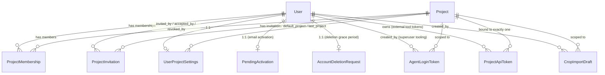
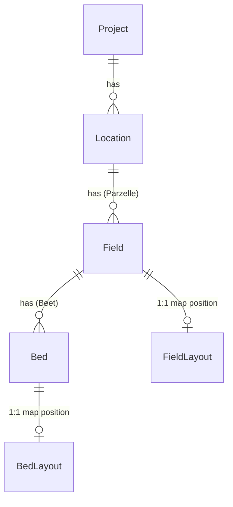
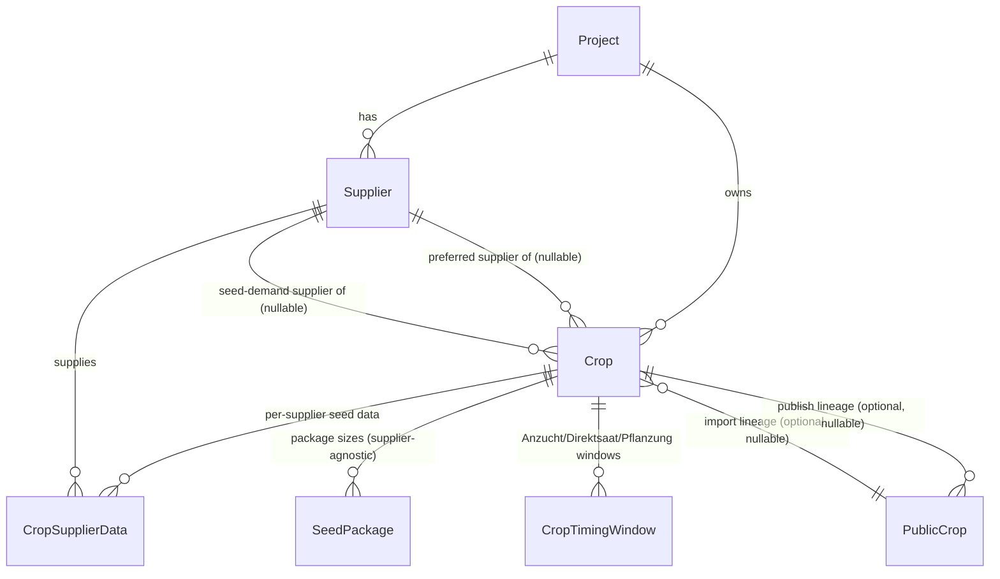
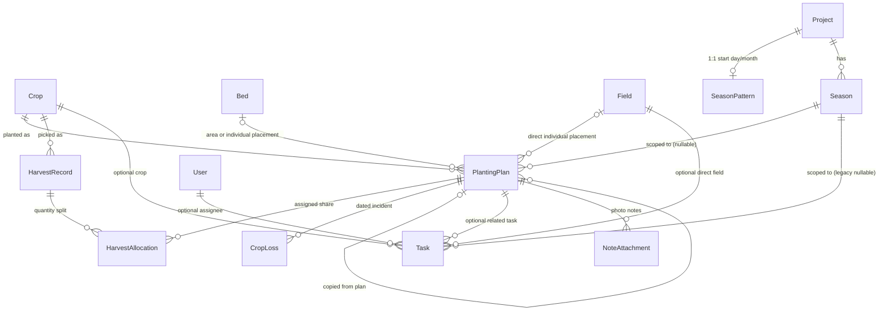
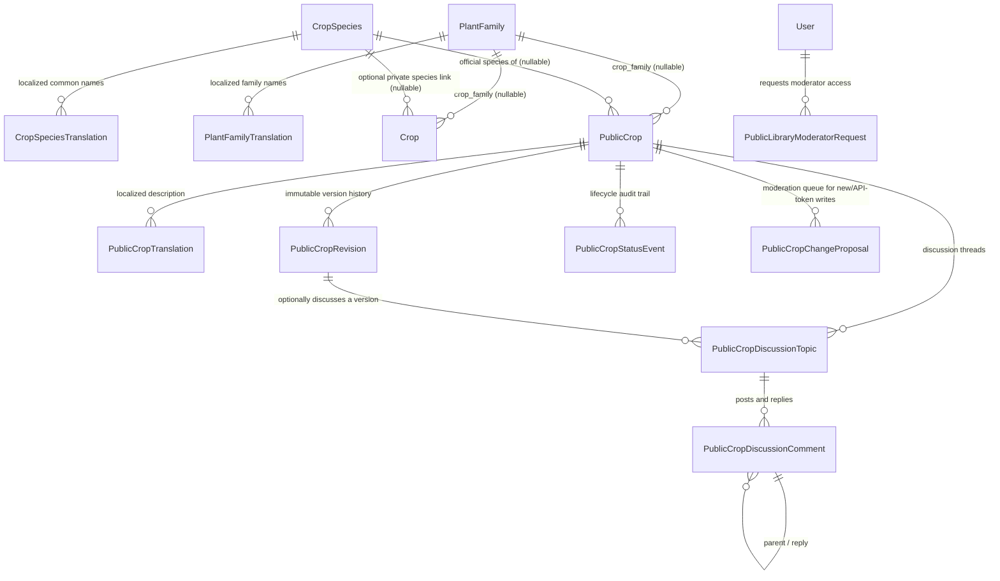
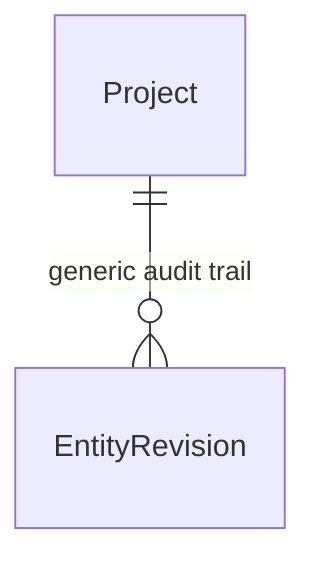
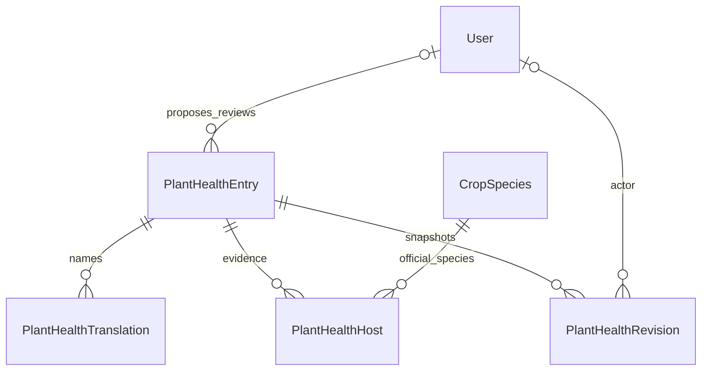

# Data Model Overview

This is a conceptual map of OpenFarmPlanner's core Django models
(`backend/farm/models/`, `backend/accounts/models.py`) and how they relate.
It is **not** a full field reference — see the model source for exact fields,
`help_text`, and validation. The goal here is to help you reason about which
objects exist, how they're connected, and which relationships matter for
typical features (a new column on the planting-plan grid, a new report, a
permission check, ...).

For the frontend/backend split and general architecture, start at
[architecture-overview.md](./architecture-overview.md).

## 1. Projects, users, and access

Every piece of farm data belongs to exactly one `Project` — projects are the
tenant boundary. A `User` (Django's built-in auth `User`, no custom user
model) gets access to a project only via a `ProjectMembership` row.

- **`ProjectMembership.role`** is either `admin` or `member` — this is the
  *entire* permission model. There is no per-object or field-level
  permission system, no "read-only" role. Ordinary CRUD on farm data
  (locations, fields, beds, crops, planting plans, tasks, ...) only
  requires *any* membership; a short list of destructive/irreversible or
  membership-changing actions (delete/restore project, change a member's
  role, remove a member, send invitations, restore-from-history) requires
  the `admin` role — enforced in view code (`require_project_admin()` in
  `backend/farm/project_context.py`), not a DB constraint.
- `UserProjectSettings.ui_language` is an account preference (`auto`, de/en/fr/es/it/pt/nl),
  independent of project membership and project content. The Italian (0017),
  Portuguese (0018) and Dutch (0019) migrations extend choices only; forward and reverse SQL are
  no-ops. They do not rewrite preferences or crop data.
- Final account deletion removes the user's `ProjectMembership` rows. Any
  project that is left with zero memberships is hard-deleted together with
  its project-scoped data. If members remain but the deleted account was the
  last admin, one remaining member is promoted to admin so the project stays
  manageable. Shared `PublicCrop` entries are not owned by a project and
  use nullable provenance links (`on_delete=SET_NULL`), so they remain part
  of the public knowledge base even when the source project is deleted.
- **`ProjectApiToken`** is the credential external tools use for API access
  outside the browser session (for example coding agents, scripts, or CI jobs).
  It is bound to one user *and* one project at creation time and stores only a
  SHA-256 digest of the token plus a short display prefix; the plaintext is
  returned once and never again. Its `scope` (`read` / `write` / `delete`) is a
  second, narrower permission axis on top of `ProjectMembership.role` — it can
  only ever *reduce* what the owning member may do, never widen it, and it
  grants no administrative access at all. The `delete` scope is limited to
  crop soft-delete/restore. **`CropImportDraft`**
  stores a validated import awaiting confirmation, which is what makes the
  preview/apply split tamper-evident. See [agent-api.md](./agent-api.md).
- Every API request that touches project-scoped data must send an
  `X-Project-Id` header (token-authenticated requests are the exception —
  their project comes from the token row); `ProjectScopedMixin` (`backend/farm/common/mixins.py`)
  resolves and validates it once per request (`initial()`), then
  auto-filters `get_queryset()` by `project=request.active_project` for any
  model that has a `project` field, and auto-injects `project` on create.
  This is the actual multi-tenancy enforcement point — see
  [architecture-overview.md](./architecture-overview.md#project-user-and-permission-model)
  for the full request-time flow.
- **`Project.deleted_at`** is the project trash marker. Soft-deleted projects
  are hidden from normal project selection, can be restored by an admin while
  `deleted_at` is set, and are permanently deleted by the scheduled
  `cleanup_deleted_projects` command once they have been in the trash for
  more than 30 days. Manual permanent deletion uses the same database cascade
  as the cleanup command.
- **`Project.default_bed_length_m`** and **`Project.default_bed_width_m`**
  are independently optional positive values in metres. Project admins can
  update them in project settings. The membership summary exposes them to
  members so new-bed forms can prefill them without another request.
- **`Project.demo_seeded_at`** marks when the demo template finished filling
  a project (empty for every other project). Seeding records crop revisions
  of its own, so the engagement dashboard only counts revisions after this
  point as user changes. Projects created before the field were backfilled
  from their seed revisions.
- **Unclear / needs check**: the invariant "a project always has at least
  one admin" is enforced only in `ProjectMembersView` view logic, not at the
  database level.

## 2. Farm structure: locations → fields → beds

- `Location` → `Field` → `Bed` is a strict three-level physical hierarchy
  ("Standort" → "Parzelle" → "Beet" in the UI). Fields/beds store area (`area_sqm`) and optional length/width
  (`length_m`, `width_m`), without polygon geometry — see
  [`archive/FIELD_BED_AREA_IMPLEMENTATION.md`](./archive/FIELD_BED_AREA_IMPLEMENTATION.md)
  for the historical rationale and the intended future geometry extension
  path.
- Locations, fields and beds carry optional site conditions (#1075): light,
  soil moisture, irrigation availability and soil type are inherited
  location → field → bed (nearest explicit value, `null` = not specified
  here); soil description, wind exposure and water supply are per-entity
  texts, and a field also records its cultivation environment. See
  [growing-area-site-conditions.md](./growing-area-site-conditions.md).
- Every project gets one location when it is created (or, for a legacy
  project without one, on the first request to the locations API). It is named
  after the project (`farm/services/default_location.py`, #1190). The name is
  user content: never translated, and renaming the project does not rename the
  location. Before #1190 the name was generated in the request's language
  ("Hauptstandort", "Main location", ...); migration
  `0146_name_single_default_locations_after_project` renamed a project's only
  location from one of those exact names to the project name and recorded a
  location revision. It cannot tell a generated name from the same name typed
  by hand, so such a manually named single location was renamed as well.
  Imports, project copies and the demo create their own locations and get no
  extra one.
- The Growing Areas list always shows a row for every location, including the
  only one of a single-location project and one without plots, so its name,
  dimensions and row actions stay reachable; the graphic view names the
  location as well (#1190). Plots are added from the location row's add action
  (or context menu); the topbar only offers "Add location".
- Each location stores recommended path gaps in metres (`bed_path_spacing_m`,
  0.30 by default, and `parcel_path_spacing_m`, 0.75 by default) and a
  `snap_to_path_spacing` preference (on by default). The location API and the
  Graphic → Spacing popover use centimetres. These values affect subsequent
  drags between measured siblings. Applying them leaves dimensions, area and
  saved positions intact.
  Metric parcel gaps require both parcels to be drawn at the location scale.
  Alignment guides also work on parcels enlarged for legibility.
  Hold Shift while dragging for free positioning, or turn off snapping in
  the popover. A gap of zero snaps opposing edges together.
- A location may carry optional outer dimensions (`length_m`, `width_m`, in
  metres, both > 0). Its `area_sqm` is read-only: their product when both are
  set, otherwise none; there is no stored location area and the dimensions are
  not checked against the fields inside (#1190). The list view edits them on
  the location row. The graphical view draws them as a dashed, labelled outer
  boundary (width horizontal, length vertical, like a field) and includes it
  when fitting the view. Its top-left corner is `Location.boundary_x/y`, in the
  same unrotated canvas units as `FieldLayout.x/y`; these are written only by
  the `locations/<id>/layouts/` endpoint (`location_boundary: {x, y}`, null
  clears) and are read-only in the location API. While unset, the boundary
  starts at the top-left corner of the plots' bounding box; the first plot drop
  saves that corner together with the plot position, so from then on the site
  stays fixed while plots move.
  Dragging a plot clamps it inside the boundary (`clampInsideBoundary`) during
  the drag and on drop; a plot larger than the site can only slide while it
  still covers the site on that axis. Overlap between plots stays allowed and
  beds keep their field-relative positions. Nothing is moved automatically: a
  plot that lies outside (e.g. after the dimensions shrank) keeps its position,
  gets a warning-coloured outline and the canvas shows a hint until it is moved
  in. Without both dimensions nothing is drawn or clamped.
- A `ParcelRotationGroup` belongs to a project. Its `ParcelRotationMember`
  rows assign each `Field` to at most one group and store its position and
  ordered bed IDs. Current bed counts are checked when configuring a group
  and when copying. Existing beds keep the saved order after renaming or
  sorting. Newly added beds join at the end until the grower reorders them.
  Groups are managed in one project-level dialog, opened from **Manage
  rotation groups** in the Growing Areas List toolbar or from a parcel's
  details, which also show its group and position. The List shows membership
  only in the optional, initially hidden **Rotation group** column; parcel
  row menus and names carry no rotation entry or badge
  ([#1576](https://github.com/OpenFarmPlanner/planner/issues/1576)).
- `BedLayout`/`FieldLayout` hold persisted x/y coordinates for the
  schematic layout view (`GraphicalFields.tsx`) — they're optional,
  separate rows from `Bed`/`Field` themselves, not embedded fields.
  `BedLayout.runs_across_parcel` defaults to `false`, which places the bed's
  length along the parcel's length. When `true`, the rendered footprint runs
  across the parcel's width with a clockwise quarter-turn of its own coordinate
  system. The bed's physical `length_m` and `width_m` stay as entered. Bed
  positions are stored relative to the legacy unrotated inner
  canvas. Graphic converts them to the physical parcel footprint on read and
  converts them back on drag save. A field
  without a `FieldLayout` (e.g. just added in the list view) is drawn next to
  the location's positioned fields (`placeFieldRects`); only when none has a
  position do fields use compact schematic rows fitted to the viewport.
  Graphic draws measured sites, parcels and beds at the same metric scale on
  both axes. Area-only records use approximate rectangles. The schematic is
  independent of georeferencing.
  The default display turns the stored layout 90° so length runs horizontally
  and width vertically. Each location has left/right 90° view controls; rotating
  refits the view and does not write layouts or change physical dimensions.
  The angle is local to the mounted view. Area names use screen-space labels
  without taking up space inside the physical footprint.
  Dragging a plot moves its canvas group, including the usable area, title and
  all beds. Snapping and the site boundary constrain the plot as a whole.
  A drop writes the plot position only, plus the site origin on the first drop
  when needed. Escape, a canceled touch, or a failed save restores the group.
  Beds remain visible in the overview. Their single-line labels always stay
  horizontal, use an ellipsis within the bed and hide only when there is
  insufficient horizontal screen space; clicking opens the full details.
  **Show tasks** optionally shades the beds by the highest urgency among
  their open tasks. It combines the active season's task list with its visible
  planting plans, including eligible carry-over plans. A task belongs to a bed
  through its planting plan. Parcel-wide and cancelled tasks are excluded.
  Due dates before today count as overdue, and the upcoming window includes
  today and the next seven days. Undated work has its own category and count.
  The legend provides a keyboard-accessible bed picker and status description.
  The bed detail route lists its tasks in due date order and uses the existing
  task status update to mark them complete.
  For local acceptance, `seed_graphical_layout_acceptance --username USER
  --database-name LOCAL_DATABASE` previews an isolated project with three plots
  and long bed names (from `backend/` via `pdm run python manage.py`). After
  verifying the local target, use `DJANGO_ENV=development OFP_LOCAL_TEST_DATA=1`
  for preview and repeat with `--apply` to create it. The command reuses the
  local fixture safeguards from `seed_library_import_acceptance`, preserves an
  existing fixture and manual edits, and never resets accounts or other projects.
  Inside a field, beds can only be placed in its usable area
  (`getFieldUsableArea` in `graphicalFieldsGeometry.ts`): a border and the
  label strip at the top stay free. The view paints that margin light grey
  and the usable area white, from the same helper the placement clamp uses,
  so drawing and placement rules cannot drift apart.
  Layout checks distinguish a footprint outside its parent, intersecting
  siblings and a gap smaller than the location recommendation. They apply to
  the drag preview and to saved geometry. Existing beds that extend outside
  the usable area after a resize are drawn at their saved position. Growing
  Areas shades metric free areas by default. Site shading covers space outside
  parcels, and parcel shading shows the usable area outside bed footprints.
  The page help explains both colors. Location and parcel Geometry sections
  show gross area, the union of child footprints clipped to the parent, and
  the remaining area and percentage. The remaining parcel area includes paths,
  margins, and other uses. Exact figures require measured outlines and
  unambiguous positioning. Moving a parcel or reassigning a bed updates the
  affected bed layout locations in the same transaction and keeps their relative
  offsets. Reads resolve the bed's current parcel so they can also use layouts
  saved before this change. Deleting a location through the API repoints those
  older layouts when their beds already belong to another location.
- `Field`, `Bed`, and most other project-scoped models below also carry a
  **direct, denormalized `project` FK** in addition to their natural parent
  (e.g. `Bed.project` in addition to `Bed.field`). This is deliberate — it's
  what lets `ProjectScopedMixin` filter *any* scoped model uniformly by
  `project`, without walking the parent chain. Don't treat it as redundant
  data to clean up.

## 3. Crop / crop domain and the seed supply chain

- **`Crop`** is project-owned: every project has its own private copy of
  every variety it grows, including growing parameters and history. It's
  soft-deletable (`deleted_at`); the default manager (`objects`) hides
  soft-deleted rows, `all_objects` doesn't (used by restore flows).
  Renaming a crop group is atomic; a conflicting active general name in the
  same project returns 409 `crop_name_conflict` without partial saves. See
  [crop-library-architecture.md](./crop-library-architecture.md#sorte--kultur-value-inheritance).
  The stored `display_color` is a base color on general crops and an optional
  project-local override on varieties. An unset variety color resolves through
  its same-project general crop. The project API returns the resolved color as
  `effective_display_color`. The existing `display_color` field still reads
  and writes the stored base or override, including the empty string for an
  inherited variety. Clients can also write a hex color or `null` using
  `display_color_override` on a variety. An explicit `null` restores
  inheritance. A variety without a canonical parent uses the default planning color.
  Past revisions contain the stored value, with no provenance distinguishing
  automatically generated colors from manually chosen ones. Existing values
  are preserved, including values that match the general crop color.
  Perennials have a positive whole-year `standing_time_years`. Varieties
  can inherit the value from their general crop. Existing perennial crops
  keep an unknown value until it is explicitly configured.
  Perennials can also record `annual_harvest_window` and
  `first_harvest_delay_years`. The whole window is inherited as one value
  and the delay is inherited separately. See [perennial harvest planning](crop-detail.md#perennial-harvest-planning).
  `creation_origin` is set by the server for a new manual, file-imported,
  or library-imported crop. It stays separate from the library link and
  licensing provenance. Rows without recorded creation evidence retain an
  unknown origin. The API can also recognize retained creation revisions
  that belong to a file-import group.
- **`PublicCrop`** is the shared, cross-project "crop library" — it has
  no owning `Project`, only optional *provenance* links back to the project
  and crop it was published from. Published rows are intended to be
  durable open-data knowledge-base entries under the public-library
  contribution terms, not ordinary user-owned records with self-service
  deletion. Its own satellite records (translations, revisions, discussions,
  status events) are in [§5](#5-public-crop-library); see
  [crop-library-architecture.md](./crop-library-architecture.md) for the
  full story of how this split is formalized into the `crops` Django app.
  Published perennial entries carry the productive lifespan along with
  the life-cycle category and any configured harvest window and delay.
- **`CropSupplierData`** is the join between one `Crop` and one
  `Supplier`: supplier-specific product data (price, packaging sizes,
  germination rate, thousand-kernel-weight, `seed_status` and
  `seed_exemption_status`). Both status fields are optional on API writes,
  default to `unknown` for new and pre-existing rows, and remain unchanged
  when an update omits them. They belong to the supplier row, never to the
  crop/variety or shared library (the variety's own open-pollinated/F1 trait is
  `seed_type`, see [Seed type](crop-library-architecture.md#seed-type-saatguttyp)).
  See [supplier seed status](supplier-seed-status.md)
  for the exemption limitations and import/export contract. `SeedPackage` is a simpler,
  supplier-agnostic "this crop comes in these package sizes" record.
  The offer's `packaging_sizes` entries can carry a decimal string `price`
  for the whole package, with one explicit `package_currency` per offer.
  `Project.default_currency` supplies the editor's default for new offers.
  The original offer-level `price` column retains legacy amounts of unknown basis.
  `Crop.selected_seed_demand_supplier` is a *separate* nullable FK from
  `Crop.supplier` (the general "preferred supplier") — it specifically
  drives which supplier's data feeds the Seed Demand calculation. See
  [seed-demand-calculation.md](./seed-demand-calculation.md) for how these
  pieces combine into an actual quantity.
- **`CropTimingWindow`** holds a crop's Anzucht, Direktsaat and Pflanzung
  windows (no harvest windows: the harvest follows from planting and growth
  duration), each in thirds of a month or ISO weeks, never as dates.
  Project data only (not in the crop library); a Sorte inherits them per kind
  from its Kultur. See [timing-windows.md](./timing-windows.md).

## 4. Planning and operations

- **`PlantingPlan`** is the operational record for one crop or variety.
  The API exposes three placement modes. `area` describes an ordinary bed
  allocation. `individual_bed` stores the parent in `bed` and sets the
  `individual_bed` flag. `individual_parcel` stores the parent in `parcel`.
  Both individual modes require a crop, a planting date and a single measured
  parent at creation. A bed can hold both area allocations and individual plans.
  Each `individual_positions` entry has a stable UUID and two coordinates in
  metres from the assigned bed or parcel's unrotated origin, to centimetre
  precision. Position edits preserve the parent and existing stem UUIDs.
  The confirmed stem count drives young-plant demand and per-plant seed and
  yield calculations. Individual plans leave exclusive area unset. A confirmed
  bed placement makes exact free area unknown while measured allocations still
  count. Estimated canopy diameter is an optional value in metres. A project
  crop may supply an initial estimate that growers can override or clear.
  Geometry edits use the plan's `updated_at` to reject a stale replacement.
  In the graphic's edit mode a saved stem is its own drag target above beds
  and parcels: dropping it saves that plan's positions at once, like a bed
  or parcel move, and a failed save restores the previous position. The
  canopy is not a drag target
  ([#1579](https://github.com/OpenFarmPlanner/planner/issues/1579)).
  Its internal `parcel_rotation_basis` retains the original occupied area and
  bed area as decimal strings after a rotating copy. Subsequent copies derive
  areas from that fraction while the current bed and area match the last
  rotation. This preserves the original areas after a complete circuit even
  though saved areas are in hundredths of a square metre.
  Its planned planting date and computed harvest dates drive the Gantt and
  bed occupancy calendar, seed demand, young plant demand, and the yield
  overview. `planting_date` anchors the main field activity, either direct
  sowing or transplanting. The nullable `planned_propagation_start_date`
  and `planned_sowing_date` preserve nursery activities independent of
  that anchor for own propagation, including dates created by an
  actual-date season copy. Ordinary propagation timing still falls back to
  the crop's duration. Changing the crop or cultivation method discards the
  old supplemental dates. Replacing the crop restores harvest calculation
  from the new crop's timing. `harvest_date_is_explicit` and
  `harvest_end_date_is_explicit` mark independently planned harvest dates
  that remain valid without a crop timing estimate. The nullable fields
  `actual_propagation_start_date`, `actual_sowing_date`,
  `actual_transplanting_date`, `actual_harvest_start_date`, and
  `recorded_harvest_end_date` capture execution independently of that schedule.
  These fields start unset for existing plans.
  The API's read-only `actual_harvest_end_date` is the calculated bed
  succession boundary. See [bed occupancy](./bed-occupancy.md).
  A perennial plan stores its own `clearing_date`. The first save suggests
  the planting anniversary from the effective productive lifespan. The
  editable stored date controls bed occupancy, regardless of later changes
  to the crop's typical lifespan or to its first harvest window. Existing
  plans without a clearing date retain their original occupancy dates.
  `harvest_window_overrides` maps an occurrence's start year to an absolute
  planned start and end date. It is stored on the original plan, independently
  of crop defaults, the plan's stored harvest snapshot, and actual harvests.
  `harvest_occurrence_actuals` keeps the optional actual start and end for each
  recurring occurrence on the same plan, keyed by that occurrence's start year.
  A scoped edit takes precedence over the legacy plan-level harvest dates for
  that year, including when it clears them. Older recurring plans retain their
  original recorded dates. The first scoped edit binds those legacy dates to
  their occurrence so that later changes to the forecast do not move them.
  Legacy plan PATCH requests still update the corresponding occurrence when
  it has a saved record.
  One-off harvests continue to use the plan-level actual start and end fields.
  Project history includes the map. A snapshot made before overrides
  or occurrence-specific actuals existed restores the corresponding empty map.
  Its `cultivation_type` is `direct_sowing`,
  `pre_cultivation` or the plan-only `purchased_transplant` (bought-in
  plants: no Anzucht, no seed demand — see
  [young-plant-demand.md](./young-plant-demand.md)).
  Its crop rotation status is computed on read from the bed's other plans;
  only a consciously accepted conflict is stored on the plan
  (`rotation_conflict_accepted_by`/`_at`) — see
  [crop-rotation.md](./crop-rotation.md).
  Season copy stores the direct source in the optional `copied_from_plan_id`
  field. The identity follows the copy through bed changes and stays available
  for lookup if the original season is restored. The detail API resolves the
  source within the same project. Project history captures the source identity.
- **`HarvestRecord`** stores one project's crop, picking date, positive
  quantity, unit and optional note. Pieces and bunches can carry a saved
  grams-per-unit factor and its source. Reference weights can come from the
  library and can be overridden on the project crop. The preferred recording
  unit belongs to the project crop. Editing either crop setting leaves
  conversion factors on historical records intact.
- **`HarvestAllocation`** links part of a record to one planting plan in
  the same project. Optional harvested area belongs to the allocation. The
  API validates the crop, date and area against the selected plans and saves
  the record and its assignments in one transaction. The assigned sum must
  fit within the record total. Deleting a plan leaves the original harvest
  and frees its former share for reassignment. Whole-project history includes
  both harvests and allocations.
- **`CropLoss`** records a dated total or partial loss on one planting plan in
  the project. The incident has a cause and an optional note. Partial extent
  may be recorded as a percentage from 0 to 100, a whole plant count or square
  metres. The amount and unit are stored together, including an explicit zero.
  The plan details give each incident its own row. The optional table column
  counts incidents by date in the active season. Incident writes affect the
  loss log and its project history. Deleting the plan removes its incidents,
  and restoring the plan through project history restores its incident rows.
- **`Season`**/**`SeasonPattern`** scope planting plans into successive
  ~12-month periods; the crop library and bed/field structure stay
  season-independent. `PlantingPlan.season` is nullable only until a
  project's first-run season setup assigns one to its pre-existing plans.
  See [seasons-architecture.md](./seasons-architecture.md) for the full
  model, the `X-Season-Id` scoping mechanism, and the copy-data/setup flows.
- **`Task`** stores manual and generated work with project/season,
  optional plan/crop/field/assignee, status and effective due date. Generator baseline
  dates and manual overrides are separate; a project/source/occurrence identity
  keeps repetitions stable across date changes. See [tasks.md](./tasks.md)
  for the CRUD/filter contract, migration and the deferred generator scope.
- There is no separate `Note` model. Free-text notes are plain `notes` text
  fields directly on `Location`, `Field`, `Bed`, `Crop`,
  `CropSupplierData`, `PublicCrop`, and `PlantingPlan`.
  `NoteAttachment` only stores *photo attachments*, and only for
  `PlantingPlan` — see
  [datagrid-architecture.md](./datagrid-architecture.md#notes--markdown-cells)
  for how these render as rich markdown+photo notes in the grid.

The Harvests overview reads `/harvests/` and `/harvests/summary/`. Both use
the record date to scope totals to the selected season. Planting-plan details
list the records assigned to that plan across its lifetime. A plan's optional
table column groups its assigned quantities in the selected season and
combines equivalent mass units. Piece and bunch quantities retain their
units. The forecast comparison uses the existing plan-scaled kilograms,
requires the full planned harvest window in the reporting period, and
disappears when a recorded quantity cannot be converted. Estimated mass
appears separately and is identified in detail comparisons. The plan's yield
per m² uses its full area. Yield per harvested m² uses only the area recorded
for an individual allocation.

## 5. Public crop library

These are the shared, cross-project records behind the public Crop Library.
None of them has a `project` FK. `CropSpecies`, `CropSpeciesTranslation`,
`PlantFamily` and `PlantFamilyTranslation` live in the `crops` app
(`backend/crops/models.py`); everything else lives in
`backend/farm/models/crops.py` alongside `PublicCrop` itself.

`PlantFamily` is the curated, admin-only plant-family list keyed by botanical
name; both `Crop.crop_family` and `PublicCrop.crop_family` reference it (see
[crop-library-architecture.md](./crop-library-architecture.md#plant-families-pflanzenfamilien)).

- **`CropSpecies`** is the language-independent identity ("tomato" is one
  row, not one row per language). Its `status` is `published` / `proposed` /
  `rejected`: a user can propose a species from the publishing wizard and
  publish against it immediately, while it stays hidden from every other
  surface until a moderator approves or rejects it. It is **nullable** on
  private `Crop` rows — free-text project crops stay valid — but
  required at the publishing boundary.
- **Translations** are separate rows, never columns: `CropSpeciesTranslation`
  holds `(species, language_code) → common_name`, `PublicCropTranslation`
  holds `(entry, language_code) → description`. Varieties are proper names and
  are never translated. See [i18n.md](./i18n.md) for the fallback rules.
- **`PublicCropRevision`** is the library's own immutable version history —
  a *different* mechanism from `EntityRevision` in §6, which only covers
  project-scoped data. Editing a public entry always appends a revision;
  reverting appends another one rather than deleting any.
- **`PublicCropStatusEvent`** records every `draft`/`published`/
  `withdrawn`/`removed` transition, which is what makes contributor withdrawal
  and moderator removal auditable instead of destructive.
- **`PublicCropChangeProposal`** is the moderation queue for crop-library
  contributions that may not apply live: those from accounts still at the
  `new` trust level and those made with a `ProjectApiToken`. `kind`
  distinguishes an edit from a new publish, the latter pointing at a
  still-`draft` `PublicCrop`. See
  [account-trust-levels.md](./account-trust-levels.md). Moderators review
  them in the contributions queue on the moderation page.
- **`PublicLibraryModeratorRequest`** backs the "request moderator access"
  flow. Approval only adds the user to the `Public Library Moderators` group
  (permission `crops.moderate_crop_species`) — it never grants staff or Django
  admin rights.
- **`CropLibraryUsageDay`** stores a count of successful selection imports or
  applied linked updates for each project, UTC date and outcome. The unique key
  is `(project, day, kind)` and the day is indexed for the dashboard and expiry.
  Each counter belongs to a `Project` and is deleted with it. `cleanup_history`
  retains 30 UTC dates of these counters. Bulk import and undo metrics use
  existing `BatchOperation` receipts.

Full behaviour, including the publishing wizard and the moderation surfaces:
[crop-library-architecture.md](./crop-library-architecture.md).

## 6. History and versioning

`EntityRevision` is the current, generic history mechanism: one row per
mutation of *any* trackable entity (`entity_type` + `object_id`, a full
JSON `snapshot`, and a diff-style `changed_fields` list). It superseded two
now-deprecated, drain-only models, `CropRevision` and `ProjectRevision`
(crop-only and whole-project-JSON-blob designs that didn't scale). See
[versioning-and-history.md](./versioning-and-history.md) for how this
powers project history and restore.

### Platform activity trends

- **`ProjectActiveUserDay`** stores one row per UTC day, project and user
  with a counted change. The unique key `(day, project, user)` supports date
  filtering and distinct-user counts across projects. The row is deleted
  with its project or user.
- **`ProjectChangeDay`** stores counts of creations, updates, deletions and
  restores by UTC day, project and workflow category. The unique key is
  `(day, project, category)`. Project deletion removes its totals.
- **`ProjectActionDay`** counts completed user actions by UTC day, project and
  primary workflow category ([#1591](https://github.com/OpenFarmPlanner/planner/issues/1591)).
  A user action is one successful signed-in write request that commits at
  least one counted object change; it counts once per changed project, in the
  category with the most changed objects (ties follow the category order).
  Previews, reads, no-op, failed or rolled-back writes and background, agent,
  staff and guest-demo writes never count, the same exclusions as above.
- **`CountedActionOperation`** marks a history `BatchOperation` that already
  counted as an action. Multi-request workflows (the batched crop spreadsheet
  import, library imports) share one batch across all their requests and
  retries, so they count once on the UTC day of their first committed change;
  a request with any change outside a batch always counts. Deleted with its
  batch or after the activity window.

The admin dashboard shows user actions as the first KPI and default trend,
with their own collection start (migration `0171_user_action_activity`);
earlier periods are unknown, not zero. Object changes remain the separate
data-volume measure.

The records support Django admin aggregates. They contain day-level activity
metadata and counts. `cleanup_history` retains 90 UTC dates of activity.

Next to those trends, the superuser usage overview shows database-wide
**History storage** across `EntityRevision`, independent of the activity filters.
PostgreSQL supplies the database and relation sizes via `pg_database_size` and
`pg_total_relation_size`, including indexes and TOAST in the relation total.
Stored snapshot sizes sum `pg_column_size(snapshot)` and reflect compression.
The overview lists the ten largest projects by stored snapshot size, using
project IDs and counts only. SQLite shows the same history counts and the ten
projects with the most entries, with byte sizes unavailable. Both backends
aggregate in SQL without loading snapshots into the dashboard.

## Unclear / needs check

- The exact session lifecycle of `AgentLoginToken` (how `agent_mode` /
  `agent_project_id` get set in the session on token consumption) wasn't
  traced end-to-end while writing this doc.
- Whether any code path other than `require_project_admin()` gates
  behavior by role — a full audit of every view wasn't performed.

## Crop-specific properties

`CropSpecies.specific_property_profile` is curated metadata referencing the
versioned property registry. `Crop.specific_properties` and
`PublicCrop.specific_properties` are independent JSON dictionaries validated
against that profile. Values do not implicitly inherit between species and
variety records. See [Crop-specific properties](./crop-specific-properties.md)
for ownership, replacement semantics, migration and exchange details.

## Germination data

`Crop` and `PublicCrop` store optional germination temperatures (°C), day
ranges, independent temperature/light requirement enums, optional stratification
duration/temperature ranges, and pre-treatment text. Explicit `none` differs
from blank/unknown; the deprecated `germination_types` list remains compatible
with older clients and preserves conflicting historical flags. These are
regular inheritable fields on project varieties and participate in library
sync and local pinning. Planning emergence dates and hints are calculated,
never stored. See [Germination](./germination.md) for the field contract.

## Site, life cycle and plant health

`Crop` and `PublicCrop` store optional `light_requirement` as a list of suitable
conditions. An empty list leaves the value unspecified and allows a variety to
inherit. `water_requirement`, `life_cycle` and `winter_hardiness` retain their
single choices, and `pests_diseases` is text. These fields take part in library
sync. Planning checks compare light and water with effective bed conditions. See
[crop-library-architecture.md](./crop-library-architecture.md#site-life-cycle-and-plant-health).

`Crop.plant_health` separately holds private structured selections as a nullable
JSON object with an `entries` array (no fixed count limit). Entries distinguish a local
name from an explicit stable catalogue UUID; names never imply identity or
confirmed host evidence. Null inherits on a linked variety, while
`{"entries": []}` is an explicit empty override. Omission preserves stored
values. Migration 0142 adds the nullable column without parsing existing prose;
history and legacy snapshots preserve that distinction.
`PublicCrop.plant_health` uses the same nullable wrapper but permits only explicit
catalogue UUID references. Schema-only migration 0143 adds its column; reversing
it drops public selections while preserving private selections and all prose.
Library comparisons use official UUID sets rather than labels or private names;
pull/update replaces only references, retaining unresolved private names and
unchanged variety inheritance. Private choices do not create official host evidence. See
[private crop selections](plant-health-catalogue.md#private-crop-selections) for
validation, portable files, rollback behavior and the guarded local fixture.

Task synchronization (#894) retains generated deletion identities in server-owned
`deleted_at` (hidden from task API reads), and uses SET_NULL for the planting-plan
relation to preserve completed and manually managed work after plan removal.

UserProjectSettings.task_drag_hint_done stores permanent retirement of the task
moving introduction per user, independently of project and table-edit hints.

CropTaskTemplate stores project/crop ownership, title, description, reference event,
signed calendar-day offset and a deletion tombstone. Task.template is nullable
with SET_NULL so task history survives template removal.

CropTaskTemplate optionally stores repeat_interval_days, repeat_until
(count/harvest_start/harvest_end), and repeat_count. Task.occurrence_index
identifies each independently completable row regardless of its calculated date.
Perennial harvest starts store the canonical harvest-window year in
`Task.occurrence_index`. The task links to the source planting plan, and its
season is assigned by the start date of its effective annual window.
`Task.suppressed_by_harvest_configuration` hides editable work that is paused
when a plan switches between one-time and recurring harvest starts. The task
keeps its ID and status while it is hidden.

## Companion note languages

`CropCompanion.notes` stores note/source prose by language; public companions
carry the same `notes` map in their existing JSON list. Identity, kind and reason
remain shared and language independent. The compatibility `note` field is
resolved to the requested language in API responses, without fallback. See
[Companion planting](./crop-companions.md) for locale patches, migration,
reciprocal pairs and reversible ordinary spreadsheet cells.

## Plant-health identities and evidence

The global catalogue is independent of project crops and their legacy plant-health
notes. No farm row or public crop is modified by the catalogue schema migration.
See [Plant-health catalogue](./plant-health-catalogue.md) for moderation and API contracts.

`PlantHealthEntry` has an immutable UUID, kind, status, scientific identity and
source metadata. Each language has one `PlantHealthTranslation` with preferred
name, synonyms, regional names and explicit documented scientific fallback.
`PlantHealthHost` records sourced, optionally variety-qualified relationships;
confirmation requires a specific pest/pathogen identity. `PlantHealthRevision`
retains complete snapshots, including archived host links. Protected entry/species
references and API archival prevent deletion of historical evidence.

### Import operation identity

`BatchOperation` now includes nullable unique `request_id`, nullable
`initiated_by` and `completed_at` for multi-request crop import groups. These
schema-only additions preserve existing season operations and old revisions.
Private context keeps first before-images/latest after-images; public history
excludes those keys. Project-state checkpoints live in `EntityRevision`, not
the deprecated `ProjectRevision` model. See
[Versioning and History](./versioning-and-history.md).

`RetainedUpload` stores unique storage paths and removal times for uploads
removed by a project restore or import undo. Its nullable project reference
uses `SET_NULL`, so deleting the project does not orphan storage cleanup work.
It is excluded from restored domain snapshots. The existing media cleanup
command removes expired unreferenced bytes after 30 days, while protecting
live media and note attachments across projects. Migration 0145 only creates
this metadata table; existing rows and files are unchanged.
