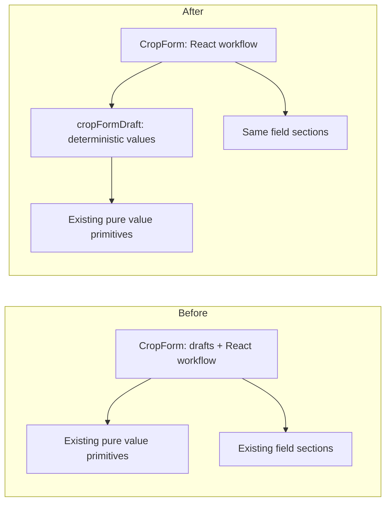

# Incremental React hotspot audit (#1118)

Baseline: main `b20e4fa588aacfcbbde39b5b2d9eb828f32bf494`, after the
crop-library boundary audit #1117. The goal is a useful responsibility split,
not a file-size target. Existing page state ownership and React Compiler
constraints remain binding.

## Coupling and responsibility baseline

Metrics below count physical source lines, top-level import declarations and
AST call sites whose identifier starts with `use` plus an uppercase letter.
Hook counts include generics/custom hooks and repeated calls, not unique
hooks. Madge 8.0.0 supplies production importers, excluding test/spec paths;
transitive counts include barrels and type dependencies, not runtime users.
These definitions differ from a simple textual hook grep.

| Component | Lines | Imports | Hook calls | State / effects | Direct / transitive importers |
| --- | ---: | ---: | ---: | ---: | ---: |
| `components/data-grid/DataGrid.tsx` | 3,098 | 62 | 150 | 12 / 13 | 1 / 23 |
| `crops/CropForm.tsx` | 2,018 | 53 | 74 | 22 / 6 | 3 / 7 |
| `crop-library/pages/PublicCropLibraryPage.tsx` | 2,480 | 77 | 122 | 32 / 13 | 2 / 3 |
| `navigation/RootLayout.tsx` | 2,111 | 68 | 94 | 19 / 4 | 1 / 2 |
| `pages/PlantingPlans.tsx` | 2,797 | 75 | 91 | 19 / 8 | 1 / 2 |

The order above prioritizes import reach, then contextual change cost. A
widely used component is not automatically the safest extraction candidate.

| Owner and existing primitives | Coupling / decision |
| --- | --- |
| `EditableDataGrid`: controlled rows, draft editing, selection/focus, commands, keyboard, context menus and continuous scrolling. Already uses `dataGridUtils`, draft readers, row-command/menu hooks and shared scrollbar primitives. | Highest import reach. Its callbacks and refs coordinate editing and focus across desktop/touch modes. A mechanical hook split or another generalized grid layer would increase risk; defer. Existing `EditableDataGrid`/row-command/menu unit suites and grid keyboard/touch E2E remain its guards. |
| `CropForm`: draft defaults and representation, library suggestions/link choices, save validation, inheritance, suppliers and dialog controls. Already reuses field sections, `varietyValueSource`, pin/link planners and form-change detection. | Second-highest import reach and a clear pure pre-component boundary. Select only deterministic draft construction. The same form serves project crops, varieties and public-library edits. Existing form, inheritance/highlighting and autocomplete suites cover the callers. |
| `PublicCropLibraryPage`: URL/storage selection, loading and refreshed data, discussion/version/moderation actions, importing and shared detail/form rendering. Already uses library filters/display adapters, import actions and discussion/detail primitives. | Highest local state/effect count. URL navigation and in-flight refs intentionally stay page-owned. #1117 already handled the safe type/identity boundaries; do not repeat that work or redesign the library. Library lifecycle/browser E2E guards the retained orchestration. |
| `RootLayout`: navigation, route/topbar actions, account/season/project state, notifications and global overlays. Already delegates sidebar/navigation primitives and account/dialog views. | Low static importer count hides route-wide runtime impact. Moving its context/state hooks would alter a broad shell. The small icon switch alone has no demonstrated shared consumer; leave it in place. Existing navigation/topbar unit and mobile/route checks remain relevant. |
| `PlantingPlans`: editable columns and coupled date/area fields, filters, selection, commands, dialogs and mobile cards. Already uses `plantingPlansUtils`, date/sowing calculations, hierarchy/search hooks, validation/dialog and toolbar/detail components. | Pure calculations already have owners; remaining columns/actions close over page state and grid refs. Splitting them would create a large callback/prop boundary. Defer until a specific repeated responsibility is demonstrated. Search, focus/escape, live-link, area-validation and grid E2E suites cover these behaviors. |

## Selected extraction: crop-form draft construction

Before, `CropForm.tsx` owned both React orchestration and these deterministic
calculations. They are now in `crops/cropFormDraft.ts`:

- `EMPTY_CROP` remains a private template with the same default values;
- `buildInitialFormData` adapts create/edit drafts, inherited values,
  spacing/seed-unit representations, legacy supplier text and stored citations;
- `buildDraftFromPublicCrop` and `getPublicCropDraftName` preserve the
  existing linked-import provenance, public-name fallback and precise
  sowing-depth conversion;
- `emptyInheritableValue` preserves the correct empty type when restoring
  inheritance, including list fields absent from the template.

The module reuses existing normalization, measurement, crop-display,
markdown and inheritance helpers. It introduces no state, hook, provider,
API client, data-fetching or replacement form component. Tests can exercise
these value contracts directly without rendering a React tree or mocking
supplier/library requests.

The complete `CropForm` function body, including hooks, handlers and JSX,
was verified byte-for-byte identical before/after the move using the
TypeScript AST declaration text. Its 74 hook call sites, 22 state calls and
six effects are unchanged. The file moves from 2,018 to 1,821 physical lines;
the new value module has 199. The small total increase buys an explicit,
independently tested responsibility boundary rather than a new abstraction
around the same state.

`publicCropFormAdapter.publicCropToCropFormData` intentionally remains
separate: it adapts public editing/presentation, while the form's library
draft establishes project import/link provenance and existing form defaults.
Their unit/nullability/name choices are not interchangeable merely because
both refer to crop facts. Existing shared fact primitives stay canonical.
No competing toolbar/detail implementation is added for #1075/#1043.

## Regression scope and rollback

Direct draft tests cover create overlays, nonmutating edit normalization,
inherited values, legacy seed units/suppliers, library fallback names,
link provenance, fractional sowing depth and typed inheritance resets.
Existing `CropForm`, variety-highlighting, autocomplete, change-detection and
public-form-adapter tests continue to exercise the actual callers. TypeScript,
changed-file ESLint and the zero-cycle Madge gate cover import boundaries.

Production-bundle `crop-form-responsive`, `library-link-lifecycle` and
`public-crop-library` browser suites cover desktop/mobile form behavior,
library matching/import/link/unlink, stable IDs and private values. The form
captures include 375/768/1024/1440 px and 800×375 landscape. Rendered strings,
sections, styling, responsive branches and requests are unchanged; screenshots
remain inspection artifacts, not pixel-baseline updates.

The local run passed 25 browser cases and all 160 targeted unit tests; all
63 generated screenshots were inspected, including French import/comparison
states. It reconfirmed the existing shared-topbar overlap tracked by #930
at 768×900 and 800×375 behind the crop dialogs. The modal layout and its
controls remain usable. The extraction changes no topbar/layout code; that
known finding stays on its existing issue rather than becoming a duplicate
or an unrelated change in this refactor.

Rollback is a single PR revert restoring the declarations/imports. No state,
stored-data, API, route or coordinated rollout migration is needed. Remaining
component/hook extractions above are deliberately deferred; file size alone
does not establish a benefit.
